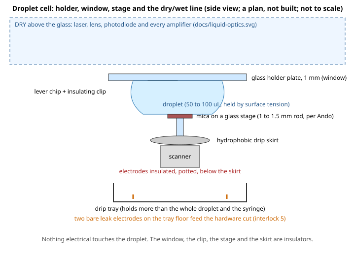

# The fluid cell, holder, seal and isolation (S9.9 of `docs/liquid.md`)

> Written 2026-11-08. **A plan on paper: nothing designed in CAD, built, bought or leak-tested.** The acceptance asks for a drawing and "a leak test with plain water and no electronics powered ... the test and its result written down": **the drawing and the test protocol are here; the test has NOT been run, so there is no result, and the issue is not done.** Tags: **[read]**, **[search]** (from a web search, not read in full), **[general]** (general knowledge, not checked), **[unknown]**.

## The idea: a droplet, not a sealed cell

A sealed cell needs a seal between a moving part and a still one, and a sealed volume needs a vent, a fill and a drain. The design here has **no moving seal at all**:
* the **cantilever chip hangs from a glass holder plate** (the window of `docs/liquid-optics.md`): the laser comes through the glass from above;
* a **droplet** of buffer, 50 to 100 uL **[general, unchecked: the figure is of the order small high-speed AFMs use; not confirmed by the sources found]**, sits between the plate and the sample and is held there by **surface tension**;
* the **sample (mica) is on a small glass stage** on the scanner. High-speed AFMs of the Ando kind put a glass rod of 1 to 1.5 mm in diameter and 2 mm in height on the Z scanner as the stage, partly to reduce the hydrodynamic force on the lever when the stage moves fast **[search: [Ando et al.](https://kanazawa-u.repo.nii.ac.jp/record/11031/files/SC-PR-ANDO-T-337.pdf)]**; the same source says the small stage limits the sample size. Whether the droplet is held the same way in those instruments is **[unknown]** (the search did not say);
* the scanner is **below the stage, dry**, under a **hydrophobic drip skirt**; under everything is a **drip tray** with leak electrodes.

This changes one picture and one number of earlier notes: the water is a droplet under the window, not a filled box with a seal, and the S9.10 proposal of "about 1 mL" for the cell is replaced by **50 to 100 uL in the droplet**, a tray sized for **the droplet plus the syringe's whole content**.

## The dry/wet line, by construction

| Part | Wet or dry | Material and why |
|---|---|---|
| Laser, lens, photodiode, amplifiers, conditioning | dry | above the glass; **no wire passes below the window plane except the scanner's** |
| Glass holder plate (window) | wet face, dry face | glass: an insulator, not attacked by buffers **[general]** |
| Lever chip and its clip | **wet** | silicon chip; the clip is an **insulator**, a plastic such as PEEK or PTFE **[general, to choose]**; **no metal in the liquid**: metals corrode in buffer and a conductive path to anything is a hazard |
| Sample (mica) and stage | **wet** | mica on a glass rod: insulators |
| Drip skirt | below the stage | a disc, hydrophobic **[general]**, so liquid that runs down the rod falls off its rim into the tray and not onto the scanner |
| Scanner | **dry, never in the liquid by construction** | its electrodes are **insulated and potted** (conformal coating or potting resin, **[general, to choose]**); it sits **below the skirt** |
| Drip tray | dry floor, catches leaks | holds more than the droplet plus the syringe; the **leak electrodes** are the only electrical parts in it, at **low voltage and low current** (below, interlock 5) |

**What cannot touch the liquid, and how:** the piezo electrodes (insulated, potted, below the skirt), the **+-12 V amplifier** and its wiring (on the board above the window plane or outside the instrument, nothing at the stage), and the **150 V** of the fast stack if one is used (`docs/hs-order.md`): with a 150 V part the **insulation, the potting and the clearance have to be designed for that voltage**, which this note does not do; **a low-voltage first build (no 150 V stack under the stage)** is the safer first step **[proposal]**.

## The leak interlock on paper (interlock 5 of `docs/liquid-safety.md`)

Two bare stainless **[general]** electrodes 20 mm apart on the tray floor, one at 3.3 V through a high resistance, the other to a comparator input with a pull-down; water or buffer between them (a salt solution conducts; **plain deionised water conducts barely and may not trip it [general, unchecked]**) lifts the input over the threshold; the comparator drives a **latch** that **opens a normally-open relay** feeding the amplifier and laser supplies, held closed only while the latch is clear: **loss of power opens it**, so the cut fails safe. It does not use the FPGA or the host. A status bit for the host is optional and is a report. **Not designed in values, not simulated, not built.** The deionised-water issue means the leak test below must also be done with **salt water** and the sensor tested with both.

## The leak test (protocol; NOT RUN)

Purpose: show, with **nothing powered**, that the droplet stays where it is put and that anything that gets out lands in the tray.
1. Set up the holder plate, a lever chip **blank** (no lever needed), the stage and skirt over the **unpowered** scanner, with a **dummy scanner** (a lump of the same size) if the real one is not to be wetted; the tray below, **weighed**.
2. Put in 100 uL of **plain water with food colouring** **[general]** by pipette.
3. Leave for **30 minutes**. Photograph at 0, 10 and 30 min. Weigh the tray and wipe-test with white paper under the skirt and on the scanner's side.
4. **Tilt** the whole assembly by 5 degrees each way and repeat the check **[general: a bench knock is a fair test]**; **tap** the table.
5. Repeat with **200 uL** (twice the design volume) and see where the overflow goes.
6. Repeat the whole test with **0.15 M salt water**, and **test the leak sensor** with a pipetted drop on the tray (plain and salt).
7. A **control droplet** next to it, not under the window, to measure **evaporation** alone **[general: a small droplet dries in minutes to hours; the loss decides how often to top up]**.

**Pass:** no colour, wetness or weight gain at the scanner side or its wiring in any run; every drop found is in the tray; the sensor trips on salt water (and the result on plain water written down, whatever it is); the evaporation loss measured. **Fail:** any wetness at the scanner side: change the skirt or the stage and repeat.

| Run | Volume | Liquid | Time | Wet anywhere but the tray? | Tray weight gain | Sensor tripped? | Result |
|---|---|---|---|---|---|---|---|
| 1 | 100 uL | water + dye | 30 min | **not run** | | | **NOT RUN** |
| 2 | 100 uL | tilted 5 deg | | **not run** | | | **NOT RUN** |
| 3 | 200 uL | water + dye | | **not run** | | | **NOT RUN** |
| 4 | 100 uL | 0.15 M salt | 30 min | **not run** | | | **NOT RUN** |

## Parts and costs

Nothing is chosen or priced: a glass plate and a droplet cost little, but **no price was found for any part here**: every price is **[unchecked]**. Candidates: a 1 mm borosilicate slide or a cut cover glass, a PEEK or PTFE clip, a glass rod of 1 to 1.5 mm, a disc skirt turned from PTFE or coated, a 3D-printed tray with a **chemically inert** liner (a printed resin may leach into the liquid and is **not** to be wetted) **[general, to confirm]**, a pipette.

## What is unsolved

* The droplet's behaviour **under the lever holder with a lever chip clipped to it**: whether the surface tension holds a stable droplet of the volume wanted over a moving stage **[unknown, the search did not say how it is done]**.
* The **mechanics** are not designed: the holder's clamp, the chip's tilt, how the coarse motor moves the holder or the scanner, the frame.
* The sample size is limited by the small stage (above): the mica and the 20 nm grating of S9.1 need to fit on a 1 to 1.5 mm stage or be mounted on a larger one, which costs scanner speed **[unknown]**.
* **150 V**: designed insulation, if the fast stack is used.
* The **leak test result**.
