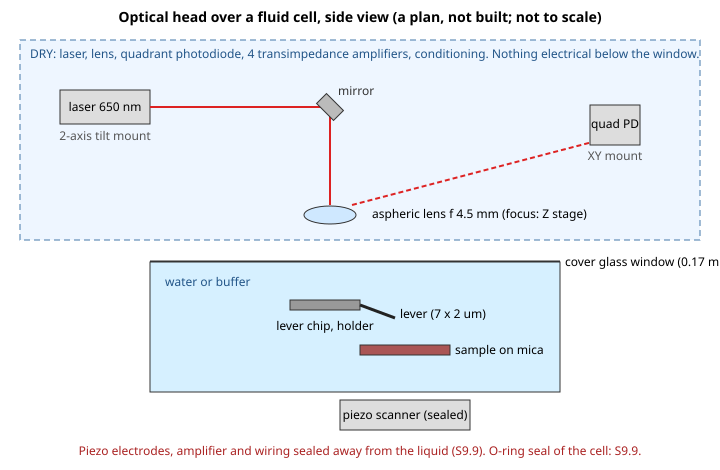

# The optical head for water (S9.8 of `docs/liquid.md`)

> Written 2026-11-08. **A plan on paper: nothing bought, built, simulated or measured.** Tags: **[read]** a page opened and read; **[snippet]** seen in a search result, page not read (stale, third-party or wrong currency possible); **[unchecked]** no price or number found; **[A]** computed here from the formula written next to it; **[general]** general optics or AFM knowledge, not checked; **[unknown]**. **No price below was read on its page today**: the earlier ones are from `docs/hs-order.md` (read 2026-11-03), the others are snippets. Currencies are as shown. This note extends `docs/hs-order.md`, whose line "optics, mirror, mount, alignment" it calls the largest unsolved item; it answers that line with a drawing, a method and a list, **not** with a built head.

## The design in one paragraph

A 650 nm laser module, a small mirror and one aspheric lens above a **glass window** focus a spot of about 3 um on the free end of the cantilever, which sits in water below the window. The reflected beam comes back through the other half of the lens, is nearly collimated, and falls on a **quadrant photodiode** some tens of millimetres away. The lever's bending tilts the beam and moves the spot on the photodiode. **Everything electrical is above the window and dry**; only the lever chip, its holder and the sample are wet. That is what makes S9.9 (seal, isolation) tractable: the optics need no wet electronics.

## What the numbers say (computed, to be checked against a real lever)

* **Spot size.** A Gaussian spot of 1/e^2 radius w0 = lambda / (pi NA) **[general, unchecked]**: at 650 nm and NA 0.14, w0 = 1.5 um, a **3 um diameter** **[A]**. The lever is **2 um wide** (USC-F1.2-k0.15, 7 x 2 um **[read, hs-order]**), so the spot spills over its width and some light is lost; a source says the spot should "substantially fill" the lever and underfilling loses detection efficiency **[search: [US 5,825,020](https://patents.google.com/patent/US5825020)]**. A smaller spot needs a larger NA and a shallower focus. **Whether the light left on the lever is enough is [unknown]**; the sum signal (S9.5) and the alignment (S9.7) are how a real head will say.
* **Depth of focus.** Rayleigh range pi w0^2 / lambda = **10.6 um** **[A]**: the focus is not critical in height, but water moves it (below).
* **Lens aperture.** A lens of 4.51 mm focal length used at NA 0.14 passes a beam of 2 f NA = **1.3 mm** **[A]**: the laser module's beam must be stopped down or expanded to that. The module's own beam size is **[unchecked]**.
* **Signal.** For a rectangular lever of length L the tilt at its tip for a tip deflection d is 3d/(2L), and the reflected beam turns by twice that, 3d/L **[general; the search above did not confirm the formula: check against a textbook]**. With L = 7 um and d = 1 nm that is 4.3e-4 rad; on a photodiode 30 mm away the spot moves **13 um** **[A]**, about **1% of a 1.3 mm beam per nanometre**. The quadrant's difference-to-sum ratio is of that order **[A, the exact ratio depends on the beam profile]**. Whether that beats the photodiode's and the amplifier's noise at 1 MHz is **[unknown]**; it is the number S9.11 should measure and compare with the twin's noise parameter (S9.4).
* **Water.** The lens focuses in air above a flat window, so the beam enters the water along the axis and bends little; the focus still shifts toward the lever by roughly the refractive-index ratio (water about 1.33 **[general]**) times the water path. It is a Z-stage adjustment, not a redesign, **[general]**; the window's thickness and tilt matter and are **[unknown]**.
* **Single lens, off-axis.** Sending the beam through one half of the lens and receiving it through the other avoids a beam splitter (which would lose 75% of the light in a plain cube) **[general]**. Whether a half aperture at NA 0.14 and the chip's own tilt (about 10 degrees on commercial holders **[general, unchecked]**) work with this lens is **[unknown]**.

## Parts (nothing bought)

| Part | Candidate and what was found | Price |
|---|---|---|
| **Cantilever** | NanoWorld USC-F1.2-k0.15: 1.2 MHz, 0.15 N/m, 7 x 2 x 0.08 um, designed for high-speed AFM in liquid (`docs/hs-order.md`) | USD 1,183 per 10 [read 2026-11-03] |
| **Laser module** | Picotronic LFD650-5-3 family, 650 nm, 5 mW, 3 V dot; one variant (8 x 22 mm, -3000H) at EUR 15.04 ex VAT per a search result; **the results did not say whether it is focusable**, and a 6 x 20 mm variant is fixed focus **[search: [Picotronic](https://www.picotronic.de/picopage/en/product/detail/id/356057)]**. The bare diode alternative (Olimex, EUR 0.50, no lens or driver) needs a driver and a collimator that are not designed | EUR 15.04 ex VAT [snippet] |
| **Lens** | Thorlabs C230TME-B (mounted, f = 4.51 mm, AR 600 to 1050 nm; the exact TMD variant was not found): USD 75 third-party eBay listing; an older catalogue lists the A230TM-B at USD 86 and the unmounted A230-B (NA 0.55) at USD 82 **[search: [eBay](https://www.ebay.de/itm/126140362271), [GoPhotonics](https://www.gophotonics.com/products/optical-lenses/thorlabs-inc/33-46-a230-b)]**. NA 0.55 is far more than the 0.14 needed, so a **cheaper, slower lens** is likely enough: **[unchecked]** | USD 75 [snippet] |
| **Quadrant photodiode** | Hamamatsu S4349: four segments, 20 MHz cutoff at 5 V bias (datasheet figure, per `docs/hs-order.md`); the RS UK listing shows GBP 37.43 ex VAT for 1 to 4 and GBP 36.31 for 5 or more, "price indicative" **[search: [RS](https://uk.rs-online.com/web/p/photodiodes/0482451)]**; First Sensor QP5.8-6 TO is an alternative with no price found | GBP 37.43 ex VAT [snippet]; QP5.8: [unchecked] |
| **Transimpedance amplifiers** | Four of TI OPA657 (one per segment) | USD 14.56 to 16.45 each [snippet from `docs/hs-order.md`] |
| **Conditioning for the AD1** (S9.5's open item, below) | Single-supply rail-to-rail op-amps, resistors and capacitors; no part chosen | [unchecked] |
| **Window and cell** | A glass cover slip (about 0.17 mm) as the window, an O-ring, a machined or printed cell body: **S9.9** | [unchecked] |
| **Mounts and stages** | A two-axis tilt mount for the laser, a Z stage for the lens, an XY mount for the photodiode and a holder for the 3.4 x 1.6 x 0.3 mm chip: **[unknown]**, not chosen; 3D-printed mounts with fine screws are a candidate for the bench, not a design | [unchecked] |
| **Safety** | A 5 mW 650 nm module is a laser of a class that needs eye protection and care **[general, unchecked]**; goggles for 650 nm and a rule for the beam path belong to **S9.10** | [unchecked] |

Totals are not given: only the read cantilever price is read, and the rest are snippets and blanks. Adding the snippets gives about EUR 15 + USD 75 + GBP 37 + 4 x USD 15 plus the unpriced mechanics, **a few hundred dollars, plus the lever box**; that is a guess about parts and not a budget.

## The conditioning S9.5 left open

The AD1 takes 0 to 3.3 V on two channels **[repo]**. On paper:
* **Sum** (slow): the four segment currents are summed, and a low-pass of about 1 kHz (the host reads about a thousand times a second at most) scales it to **about 1.6 V at the nominal light**, so the AD1 reads the twin's nominal 2,000 counts. The 95% fade limit of S9.6 then needs a stability of the whole chain of about 1% over a run **[unknown]**.
* **Deflection DC** (slow): the vertical difference, low-passed, on a **1.65 V mid-scale offset** so the AD1 reads 2,048 when centred; it is the quantity the S9.6 range check watches (2,048 +- 1,000 counts).
* **Deflection AC** (fast): the same difference, AC-coupled and band-limited around the lever's frequency, scaled to the **AD9226 module's** input (a 2 V reference per `docs/hs-order.md`; the module's real input range **[unchecked]**), with its offset centred.
* No division of the difference by the sum is done; the host does it if it wants, from the two slow readings. **No value in this list was simulated and no part was chosen.**

## The alignment method (by hand, then by the software)

1. **Eye safety first** (S9.10). Laser at the lowest power that shows.
2. **In air, cell empty, no water:** with the laser off the lever, put the chip in its holder; use a cheap camera or a loupe on the chip to see it **[general]**. Move the lens on its Z stage until the spot on the chip is smallest; then walk the spot onto the lever with the laser's tilt mount, using the **sum on the photodiode**: it rises when the spot is on the lever **[general]**. This step is what `host/align.cho` does (S9.7): the operator moves one screw through positions and the program names the best and refuses a dark, edge or unrepeatable result; two screws are done one after the other.
3. **Centre the photodiode** with its XY mount until the two differences read zero on a meter, by hand: the software has only one deflection register, so it cannot do the quadrant centring (S9.7 says so).
4. **Fill the cell** and repeat the focus: the water moves it. Check the sum again; a drop over minutes is a leak of light or a lens that is moving (S9.6 refuses at 5%).
5. Run `session` profile 2 (S9.6).

## What is still unsolved

* Whether a 3 um spot on a 2 um lever leaves enough light, and whether the whole head's noise allows the setpoint margin of S9.6 **[unknown, S9.11]**.
* The Z range (S9.1 decision 1) and a stiff enough, drift-free mechanical frame: **no mechanics designed**.
* The photodiode amplifier's real bandwidth with the photodiode's capacitance **[unchecked]**.
* A second deflection axis in the register table (S9.7).
* The prices above are not read.
